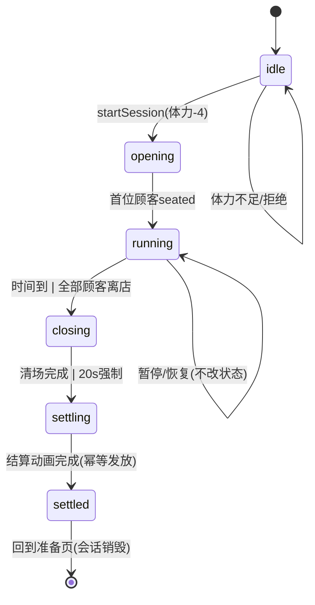
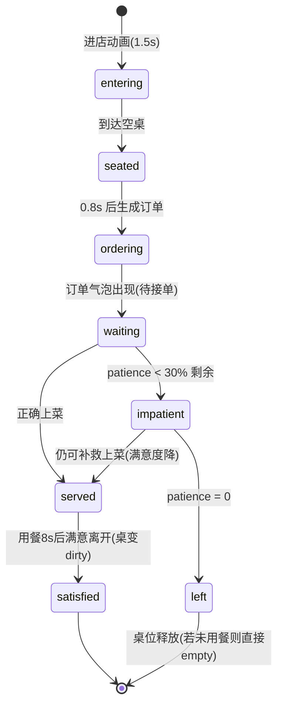

# R3 产品与交互规格

版本：V1.0
日期：2026-10-13
任务编号：R3-01
责任：WorkBuddy
依据：`08_R3互动营业执行计划书.md` V1.0
读者：DeepSeekHarness（R3-02 实现）、QA（R3-03）
约束：本规格只允许写入 `work/r3/**`，不修改 `app/src/**`。

---

## 0. 术语与总原则

- 字段命名一律英文 `camelCase`，页面展示文案一律中文。
- 状态机是唯一事实来源：营业会话中订单、设备、托盘、桌位只允许通过动作函数（`dispatch(action)` 风格的纯函数 reducer）修改，不允许组件直接 setState 业务对象。
- 游戏状态（`GameState`，写入存档）与营业会话状态（`CafeSession`，营业期内存，不写入存档）严格分离。
- 所有结算必须幂等：以 `sessionId` + `settled` 标志双重防护。
- R3 配方 ID 使用新命名 `seaSaltLatte` / `butterCroissant` / `citrusSparklingWater`，各自携带 `legacyRecipeId`（`latte` / `croissant` / `soda`）用于对接现有 `GameState.recipes` 解锁数组，避免改存档结构。

---

## 1. 一天完整流程（日循环）

```
准备(prepare) → 开店营业(opening→running→closing) → 打烊结算(settled)
→ 升级/养宠/恋爱(interlude) → 回到准备(prepare)
```

| 阶段 | 页面 | 玩家可做的事 | 系统做的事 | 退出条件 |
|---|---|---|---|---|
| 准备 | 准备页 `CafePreparePage` | 查看菜单/设备/装饰/今日目标/布丁状态；研发菜单、升级设备、购买装饰 | 展示今日目标、体力、金币 | 点击"开店营业"并扣体力成功 |
| 营业 | 营业页 `CafeRunPage` | 接单、取料、加工、组装、上菜、清理、处理事件 | 计时、生成顾客与订单、触发事件、扣除耐心 | 倒计时归零或所有顾客离店 |
| 收尾 | 营业页（closing 状态叠加层） | 完成进行中的订单、清理桌面 | 停止新顾客进店 | 无未完成订单且无待清桌面，或 20 秒强制收尾 |
| 结算 | 结算页 `CafeSettlePage` | 查看收益/评价/成长，领取奖励（一次性） | 幂等发放金币/经验/关系/宠物变化，写存档 | 点击"回到店里" |
| 回流 | 准备页（结算后） | 升级设备、喂布丁、读角色短信/剧情提示 | 解锁下一步内容 | 再次点击"开店营业" |

关键规则：

1. 开店扣体力 `BUSINESS_STAMINA_COST = 4`（沿用 `app/src/game/storage.ts` 现值）。体力不足时按钮禁用并提示。
2. 结算后回到准备页，日序号 `dayIndex`（运行时计数，不入存档）+1，用于事件轮换。
3. 宠物与恋爱回流发生在结算页与准备页，不阻塞营业循环（见 §8/§9）。

---

## 2. 页面状态

| 状态 | 值（英文字面量） | 进入条件 | 内容 | 退出 |
|---|---|---|---|---|
| 准备页 | `prepare` | 默认；结算完成返回 | 菜单、设备、装饰、今日目标、布丁状态、开店按钮 | `startSession` 成功 → `opening` |
| 营业页 | `opening` / `running` / `closing` | `startSession` 成功 | 三层布局（§10） | 倒计时归零 → `settling`；全部完成 → `settling` |
| 结算页 | `settled` | 结算动画（≤1s）完成 | 收益明细、评价、成长、回流入口 | 「回到店里」→ `prepare` |
| 离店确认弹窗 | `exitConfirm`（布尔，营业页内） | 营业中点击关闭/切换标签 | 确认文案 + 「继续营业 / 结束并结算」 | 选任一按钮关闭 |
| 暂停 | `paused`（布尔，营业页内） | 离店确认弹窗打开、`visibilitychange` 隐藏、窗口失焦 | 顶部暂停遮罩，倒计时与耐心冻结 | 恢复焦点或关闭弹窗 |

强制规则：

- 营业中不渲染底部导航（用 `CafeRunPage` 全屏接管）。
- `visibilitychange === 'hidden'` 或 `window.blur` → 立即 `paused = true`，计时器停走；恢复后需点击「继续」或自动（焦点回来即恢复，恢复有 500ms 防抖）。
- 浏览器刷新/关闭：营业中会话丢弃（体力已扣不返还，见 §11 防刷规则），但已 `settled` 的结算绝不重复发放。

---

## 3. 核心领域对象与字段

新增文件边界（与 R3-02 任务书一致）：`cafeTypes.ts`（类型）、`cafeSession.ts`（纯逻辑 reducer）、`cafeContent.ts`（常量）。以下类型全部落在 `cafeTypes.ts`。

### 3.1 营业会话 `CafeSession`

| 字段 | 类型 | 默认值 | 说明 |
|---|---|---|---|
| `sessionId` | `string` | 必填（生成规则：`r3-{dayIndex}-{Date.now().toString(36)}`） | 幂等键 |
| `phase` | `'opening' \| 'running' \| 'closing' \| 'settling' \| 'settled'` | `'opening'` | 会话阶段 |
| `paused` | `boolean` | `false` | 暂停标志 |
| `elapsedMs` | `number` | `0` | 已用营业毫秒（不含暂停） |
| `durationMs` | `number` | 必填（150_000，见数值表） | 本轮时长 |
| `dayIndex` | `number` | 必填 | 第几天（事件轮换用） |
| `customers` | `Customer[]` | `[]` | 顾客列表 |
| `tables` | `TableState[]` | 必填（4 桌初始化） | 桌位 |
| `orders` | `Order[]` | `[]` | 订单 |
| `devices` | `Record<DeviceId, DeviceRuntime>` | 必填 | 设备运行态 |
| `tray` | `TrayState` | 必填 | 托盘 |
| `events` | `SessionEvent[]` | `[]` | 已触发事件记录 |
| `stats` | `SessionStats` | 必填 | 见 3.8 |
| `settled` | `boolean` | `false` | 幂等标志 |
| `lastActiveAt` | `number` | 必填 | 空档检测锚点 |
| `idleHintShownAt` | `number \| null` | `null` | 上次空档提示时间 |

### 3.2 顾客 `Customer`

| 字段 | 类型 | 默认值 | 说明 |
|---|---|---|---|
| `id` | `string` | 必填（`c{序号}-{rand}`） | |
| `typeId` | `CustomerTypeId` | 必填 | `officeWorker / tourist / catLover / regular` |
| `tableId` | `string` | 必填 | 落座桌位 |
| `status` | `'entering' \| 'seated' \| 'ordering' \| 'waiting' \| 'served' \| 'satisfied' \| 'impatient' \| 'left'` | `'entering'` | |
| `patienceMs` | `number` | 按类型配置 | 剩余耐心（毫秒） |
| `patienceMaxMs` | `number` | 同上 | 耐心上限（画进度条用） |
| `preference` | `OrderPreference \| null` | `null` | 偏好要求（少糖/加热/双份/装饰） |
| `arrivedAtMs` | `number` | 必填 | 进店时间（会话内） |
| `tipBonus` | `number` | `0` | 宠物/角色事件带来的临时小费加成 |

### 3.3 桌位 `TableState`

| 字段 | 类型 | 默认值 | 说明 |
|---|---|---|---|
| `id` | `string` | `t1..t4` | 固定四桌 |
| `status` | `'empty' \| 'occupied' \| 'hasOrder' \| 'served' \| 'dirty'` | `'empty'` | |
| `customerId` | `string \| null` | `null` | |
| `orderId` | `string \| null` | `null` | |
| `plateItem` | `string \| null` | `null` | 桌上空盘（待清理物） |

### 3.4 订单 `Order`

| 字段 | 类型 | 默认值 | 说明 |
|---|---|---|---|
| `id` | `string` | 必填 | |
| `recipeId` | `CafeRecipeId` | 必填 | 三种配方之一 |
| `customerId` | `string` | 必填 | |
| `tableId` | `string` | 必填 | |
| `qty` | `1 \| 2` | `1` | 双份订单 |
| `preference` | `OrderPreference \| null` | `null` | 见 3.5 |
| `status` | `'new' \| 'accepted' \| 'crafting' \| 'assembled' \| 'onTray' \| 'served' \| 'timeout' \| 'failed'` | `'new'` | |
| `stepIndex` | `number` | `0` | 当前制作步骤下标 |
| `createdAtMs` | `number` | 必填 | |
| `acceptedAtMs` | `number \| null` | `null` | 接单时间（计算满意度） |
| `servedAtMs` | `number \| null` | `null` | 上菜时间 |

### 3.5 偏好 `OrderPreference`

```ts
type OrderPreference =
  | { kind: 'lessSugar' }      // 少糖：装配时点击「少糖」选项
  | { kind: 'heated' }         // 加热：可颂出炉后点「加热」
  | { kind: 'extraShot' }      // 双份浓缩：咖啡机长按时按两次
  | { kind: 'garnish' }        // 加柑橘片装饰：装配台点「加装饰」
```

偏好从订单气泡展示；漏做偏好只降低满意度与小费（-40% 小费），不判失败。

### 3.6 制作步骤 `CraftStep`（静态定义，运行态存于 `Order.stepIndex` + `DeviceRuntime`）

```ts
interface CraftStep {
  stepId: string            // 如 'grind' | 'brew' | 'steamMilk' ...
  action: 'tap' | 'dragTo' | 'longPress' | 'swipe' | 'choose'
  target: DeviceId | 'tray' | 'table' | 'ingredient' | 'option'
  ingredient?: string       // dragTo ingredient 时必填
  durationMs?: number       // longPress 时长
  toleranceMs?: number      // 长按允许误差（提前/超时范围）
  options?: string[]        // choose 时的选项 id 列表
  label: string             // 中文提示文案
}
```

### 3.7 设备运行态 `DeviceRuntime`

| 字段 | 类型 | 说明 |
|---|---|---|
| `deviceKey` | `'coffeeMachine' \| 'oven' \| 'assembly' \| 'wash'` | `tray` 单独由 `TrayState` 管理 |
| `slots` | `DeviceSlot[]` | 并行槽位（数量由设备等级决定） |
| `queueOrderIds` | `string[]` | 排队订单 |

`DeviceSlot`：`{ slotIndex: number; orderId: string | null; stepId: string | null; startedAtMs: number | null; doneAtMs: number | null; progress: number }`。

### 3.8 托盘 `TrayState` 与会话统计 `SessionStats`

```ts
interface TrayState {
  capacity: number                 // 默认 1，吧台 Lv3 → 2
  items: TrayItem[]                // { itemId, orderIds: string[], createdAtMs }
}

interface SessionStats {
  ordersServed: number
  ordersTotal: number
  ordersTimeout: number
  coinsBase: number
  coinsTips: number
  expGained: number
  satisfactionSum: number          // 用于平均满意度
  perfectCount: number             // 满意度≥90 的订单数
  interactions: number             // 有效交互计数（验收用）
}
```

### 3.9 事件 `SessionEvent`

```ts
interface SessionEvent {
  id: string
  defId: string                    // 指向内容配置的事件 id
  triggeredAtMs: number
  resolvedAtMs: number | null
  pausedTimer: boolean             // 该事件是否冻结计时
}
```

---

## 4. 会话状态机

### 4.1 状态表

| 状态 | 进入条件 | 期间发生 | 退出条件 | 失败条件 |
|---|---|---|---|---|
| `idle`（无会话） | 初始 | — | `startSession` 校验通过（体力≥4） | 体力不足 → 拒绝并提示，留在准备页 |
| `opening` | 开店成功 | 0–3s：门铃动画，前 2 位顾客 `entering` | 第一位顾客 `seated` | 无 |
| `running` | 首位顾客落座 | 计时、生成顾客/订单/事件 | `elapsedMs >= durationMs` → `closing`；所有顾客离店且无订单 → `closing` | 无（营业不会失败） |
| `closing` | 倒计时归零或清场 | 不再进新客；进行中订单可完成；20s 强制截止 | 无进行中订单且无 `dirty` 桌 → `settling`；或强制 20s 到 → `settling` | 无 |
| `settling` | 收尾完成 | 结算动画 ≤1s（纯前端） | 动画结束 → `settled` | 无 |
| `settled` | 结算完成 | 幂等发放奖励，写存档 | 点击「回到店里」→ 销毁会话 | 重复触发结算被 `settled` 标志拦截 |

### 4.2 Mermaid 状态图



### 4.3 顾客状态机



| 状态 | 耐心是否流动 | 备注 |
|---|---|---|
| `entering`/`seated`/`ordering` | 否 | 走固定动画时间 |
| `waiting`/`impatient` | 是 | 暂停时冻结 |
| `served`/`satisfied`/`left` | 否 | 终态 |

### 4.4 桌位状态机

`empty → occupied(顾客坐) → hasOrder(订单生成) → served(上菜) → dirty(顾客离开) → empty(清理完成)`

清理动作：滑动桌面或把空盘拖到洗涤区，两者等价。

---

## 5. 三种配方的操作链

每个动作 = 1 个有效交互（计入 `SessionStats.interactions`）。单份订单 4–6 个交互；双份订单上限 8 个。

### 5.1 海盐拿铁 `seaSaltLatte`（咖啡机，6 步，含 1 步可跳过）

| # | stepId | 动作 | 交互方式 | 时长/误差 | 失败与补救 |
|---|---|---|---|---|---|
| 1 | `confirmOrder` | 确认顾客偏好 | 点击订单气泡 | — | 无失败 |
| 2 | `placeCup` | 把杯子拖到咖啡机 | 拖拽 `cup` → `coffeeMachine`（备选：点杯子再点咖啡机） | — | 放错设备→弹回原料槽，不销毁 |
| 3 | `brew` | 长按萃取 | 长按 1200ms，容差 ±300ms（不足=萃取不足，超过=过萃） | 1200/±300 | 超差→产物标记 `imperfect`，可倒掉重来（消耗原料）或继续（满意度-20） |
| 4 | `steamMilk` | 奶壶拖到蒸汽口并滑动控制奶泡 | 拖拽 + 上滑手势（备选：拖入后点「打发」按钮 3 连击） | 滑动 800ms | 中断→重滑，不消耗 |
| 5 | `assembleLatte` | 咖啡+奶泡拖到装配台组装 | 两次拖拽到 `assembly`（备选：点选原料后点装配台） | — | 顺序颠倒不判失败（拿铁可先奶后咖） |
| 6 | `serveToTable` | 成品拖到托盘再拖到餐桌 | 拖拽 `tray` → 目标桌（备选：点托盘→点「上菜」→点桌） | — | 上错桌→3s 内可拿回，超时顾客拒绝（满意度-30） |

偏好 `extraShot`：在步骤 3 长按前点一次「双份浓缩」开关（不加交互数）。

### 5.2 黄油可颂 `butterCroissant`（烤箱，5 步）

| # | stepId | 动作 | 交互方式 | 时长/误差 | 失败与补救 |
|---|---|---|---|---|---|
| 1 | `confirmOrder` | 确认偏好（是否加热） | 点击订单气泡 | — | — |
| 2 | `placeDough` | 生胚拖入烤箱托盘 | 拖拽 `dough` → `oven` | — | 放错→弹回 |
| 3 | `bake` | 长按烘焙 | 长按 1500ms，容差 ±400ms | 1500/±400 | 超差→烤焦/未熟，可丢弃重烤（消耗原料）或照常上菜（满意度-25） |
| 4 | `butterOption` | 加黄油 / 选择加热 | 点击选项 `addButter` / `servePlain`；若偏好 `heated` 须先点「加热 1s」 | — | 漏做偏好→小费-40% |
| 5 | `plateAndServe` | 拖到餐盘再上桌 | 拖拽 `oven`→`tray`→桌 | — | 上错桌同 5.1 |

### 5.3 柑橘气泡水 `citrusSparklingWater`（装配台，6 步）

| # | stepId | 动作 | 交互方式 | 时长/误差 | 失败与补救 |
|---|---|---|---|---|---|
| 1 | `confirmOrder` | 确认偏好（加柑橘片） | 点击气泡 | — | — |
| 2 | `addIce` | 取杯加冰 | 拖拽 `cup` + `ice` 到装配台（两次拖拽算 1 个交互：点杯子后冰块自动入杯；备选两次点击） | — | — |
| 3 | `addSyrup` | 拖入柑橘糖浆 | 拖拽 `syrup` → `assembly` | — | 放错→弹回 |
| 4 | `pourSparkling` | 长按气泡水阀注入 | 长按 1000ms，容差 ±300ms | 1000/±300 | 超差→气泡不足/溢出，可重注一次（不消耗原料，+1 交互） |
| 5 | `garnishOption` | 是否加柑橘片装饰 | 点击 `addGarnish` / `noGarnish`（偏好 `garnish` 须选加） | — | 漏偏好→小费-40% |
| 6 | `serveToTable` | 托盘上桌 | 同 5.1 步骤 6 | — | 同上 |

### 5.4 点击备选路径（总规则）

- 每个拖拽目标都有「先点源、源高亮、再点目标」的两击等价路径。
- 每个长按都有「连点 3 次替代按钮」的等价路径（进度按点击次数 33%/66%/100%）。
- 每个滑动都有「点击推进」按钮。
- 备选路径与手势路径产出完全相同的 reducer 动作，不允许出现只有手势能完成的订单。

---

## 6. 事件触发规则（20–30s 一次）

| 规则项 | 冻结值 |
|---|---|
| 触发间隔 | 距上个事件 `22000–28000ms` 随机（首次在 `15000ms` 内） |
| 是否暂停计时 | 顾客事件不暂停；设备小故障暂停 `3000ms`；宠物/角色事件暂停 `2500ms`（对白展示期间） |
| 事件来源权重 | 顾客 40% / 设备 25% / 宠物 20% / 角色 15%（角色事件每会话最多 1 次，若无可用角色则重定向到宠物） |
| 冷却 | 同一 `defId` 会话内最多出现 2 次，两次间隔 ≥60s |
| 队列 | 同一时刻只展示 1 个事件；若触发时上一个未处理，顺延 8s |

事件定义（触发条件、效果、文案）见《R3内容配置.md》§5。

---

## 7. 设备占用、排队、并行与托盘规则

| 规则 | 冻结值 |
|---|---|
| 咖啡机槽位 | Lv1–2：1 槽；Lv3–4：2 槽（双杯并行）；Lv5：2 槽 + 萃取长按缩短 20%（1200→960ms） |
| 烤箱槽位 | Lv1–2：1 槽；Lv3–4：2 槽（双批）；Lv5：2 槽 + 烘焙时长 1500→1100ms |
| 装配台 | 永不占用排队（可同时组装多单），但一次只能进行一个组装手势 |
| 排队 | 设备满载时新订单可「预排」：点击设备把订单 id 入 `queueOrderIds`，槽位空出自动开工 |
| 托盘容量 | 吧台 Lv1–2：1 件成品；Lv3+：2 件 |
| 错误放置恢复 | 原料/成品拖到错误目标→弹回原处 + 抖动动画，不消耗、不销毁；上错桌→3s 内可取回 |
| 中断恢复 | 长按中途松手→进度保留 3s，3s 内继续按压可续，超时回退到该步骤起点 |
| 洗涤区 | 一次只能洗 1 桌的餐具，清洗时长 1500ms（滑动或拖入空盘） |

---

## 8. 宠物协助（布丁）

| 触发点 | 持续时间 | 反馈 |
|---|---|---|
| 某桌顾客 `impatient` 时自动跳到该桌 | 3s | 顾客耐心 +20% 上限值；桌上出现爱心粒子（CSS） |
| 事件 `petDeliver` 触发时 | 一次性 | 帮玩家把一件成品从装配台送到托盘（省 1 个拖拽交互） |
| 事件 `catLoverVisit`（猫爱好者顾客） | 该顾客在场期间 | 该顾客小费 `tipBonus +4` |
| 打烊时 | — | 生成 1 条营业日记写入 `PetState.diary`（模板见内容配置 §5.3） |

规则：布丁协助每会话最多 3 次（impatient 救援 + 递送合计）；不替代任何制作步骤。

---

## 9. 恋爱角色到店事件

| 项 | 冻结值 |
|---|---|
| 角色选择 | `linche`（林澈）或 `guhuai`（顾淮），按 `relationships[].met` 优先已登场角色；都未登场则不触发 |
| 触发点 | `running` 阶段第 60–120s 之间的事件槽 |
| 持续 | 到店对白 2.5s（计时暂停）+ 下 1 份该角色桌上的订单获得 `tipBonus +6` 与关系值 +2 |
| 对白 | 依据关系值分档（0–30 / 31–70 / 71–100），文案见内容配置 §5.4 |
| 上限 | 每会话 1 次；关系值增长每会话最多 +2 |

---

## 10. 营业界面分区（三层）

1. **上层（约 22% 高）**：倒计时、已上菜数、四桌缩略状态、订单气泡、耐心条。
2. **中层（约 33%）**：店内场景动画区（顾客走动、布丁位置、当前事件横幅）。
3. **下层（约 45%）**：原料槽（上排）、设备区（咖啡机/烤箱/装配台/洗涤区）、托盘、操作提示条。

布局坐标（430×932 与 375×812 双视口的具体区域表）在《R3内容配置.md》§6。

交互规范（沿用计划书 §9.2，冻结为验收口径）：

- 热区 ≥ 44×44 逻辑像素；拖拽目标热区比图标大 8px。
- 拖拽必须有拿起态、跟随、可放置高亮三反馈；长按必须有进度环。
- 营业页 `overflow: hidden`，禁用页面滚动，拖拽用 Pointer Events 独立处理。

---

## 11. 结算幂等、暂停、刷新与防重复奖励

| 场景 | 冻结规则 |
|---|---|
| 结算入口唯一 | 只允许 `settling → settled` 转换中的 `settleSession()` 调用 `actions.settleBusiness`；`settled === true` 时任何再次调用直接 return |
| 会话内上菜即时入账 | 沿用现有 `serveOrder`（每单即时加金币/经验），结算只发完美奖励与统计 —— 与现有 `BusinessView` 行为一致，避免双发 |
| 刷新/关闭页面 | 营业中会话是内存态，刷新即丢弃：已 `serveOrder` 的即时入账已在 localStorage（320ms 防抖），未完成订单不补偿；体力不返还（防刷：见验收 R3-RECOV-05） |
| 重复结算防护 | `settleBusiness` 内部依赖 `stats.businessRuns` 只增不减 + 会话 `settled` 标志；QA 脚本双击结算按钮验证金币只加一次 |
| 暂停规则 | `paused === true` 时：倒计时、耐心、事件计时、设备进度全部冻结；恢复用同一时钟锚点补偿 |
| 失焦 | `document.hidden` → 自动暂停；回来后显示「已暂停」遮罩，点击继续 |
| 退出营业 | 离店确认弹窗期间自动暂停；「结束并结算」走 closing→settling 正常链路 |

---

## 12. 尚未决策的问题（不阻塞实现，实现方按默认值执行）

| # | 问题 | 默认处理 | 需产品负责人确认 |
|---|---|---|---|
| 1 | 营业时长档位（90/120/150/180s）是否开放玩家选择 | R3 固定 150s | 是否要 90s 快捷档 |
| 2 | 双份订单（qty=2）是双倍交互还是共享步骤 | 共享步骤链，仅咖啡萃取/气泡注入需按两次 | 确认 |
| 3 | 角色事件是否消耗金币 | 不消耗 | 确认 |
| 4 | 原料是否有库存上限（补货动作的深度） | R3 原料无限，补货仅作为空档动作（+2 金币小费） | R4 是否引入库存 |
| 5 | 熟客「固定偏好」的具体绑定 | 熟客偏好固定为上一次被正确服务的偏好 | 确认 |

---

## 13. 与现有代码的对接点（只读，不改名）

| 现有接口 | R3 用法 |
|---|---|
| `GameState.equipment: Record<string, number>` | key 沿用 `machine/oven/counter/signboard`，等级映射见内容配置 §4 |
| `GameState.recipes: string[]` | 用 `legacyRecipeId`（`latte/croissant/soda`）判断配方可用 |
| `GameState.stats.ordersServed / businessRuns / perfectRuns / coinsEarned` | 结算时沿用 `serveOrder` / `settleBusiness` 已有路径累计 |
| `actions.startBusiness / serveOrder / settleBusiness / upgradeEquipment / researchRecipe / buyDecor / petAction` | 全部复用，不新增签名；`settleBusiness(served, total, perfect)` 语义不变 |
| `PetState.diary` | 打烊日记用现有 `DiaryEntry` 结构 push |
| `Relationship.value` | 角色到店事件 +2 走现有 `chooseStory` 之外的新轻量路径：由 R3-02 在 reducer 增加 `bumpRelationship` 内部 action（不改公开 API） |
| `BUSINESS_STAMINA_COST = 4`、`STAMINA_REGEN_MS = 90_000` | 直接引用，不改值 |
